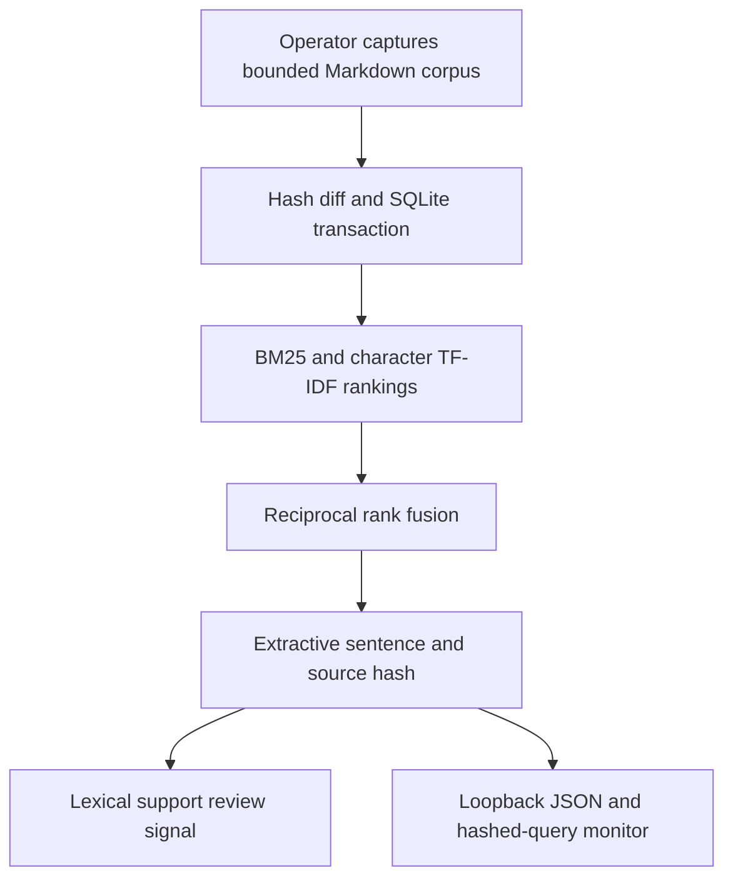

# Evidence Ledger RAG

An incremental documentation-retrieval service with hybrid lexical search, exact-span citations, and a deliberately limited evidence-support review guard.

[](https://github.com/Sunnyvulli/evidence-ledger-rag/actions/workflows/verify.yml)

**Inspect:** [recorded-results explorer](index.html) · [raw evaluation](results/evaluation.json) · [failure analysis](docs/failure-analysis.md) · [decisions](docs/decisions.md). This reference system assembles extractive answers; it does not evaluate free-form model generation. The browser explorer displays recorded results, not a live backend.

## Why this exists

An engineer investigating an unfamiliar pipeline needs to find the exact design or failure note behind an answer. This project indexes the owner's actual lakehouse, MCP and Mobility documentation, replaces changed documents transactionally, preserves unchanged chunk identities, and attaches source hashes to returned sentences. It makes provenance inspectable without a model credential or paid endpoint.

## Quick start

Python 3.12 and GNU Make are the tested prerequisites. One command runs ingestion, a cited query, and the evaluation after dependencies are installed:

```sh
python3 -m venv .venv
. .venv/bin/activate
pip install -r requirements.txt
make run
```

For the actual local HTTP service, run `make serve`, then in another terminal:

```sh
curl -s http://127.0.0.1:8090/health
curl -s http://127.0.0.1:8090/query -H 'Content-Type: application/json' \
  -d '{"query":"How is approval bound to a proposal?","k":3,"method":"hybrid"}'
```

`make test` executes 16 behavioral tests, including real HTTP requests, failed indexing rollback/retry, unchanged database bytes, missing-index behavior and monitor-sink failure. `python -m ledger.cli ingest --corpus knowledge` is an explicit operator action; HTTP cannot mutate the index. No clean-OS five-minute promise is made.

## Recorded highlights

On 10 snapshotted owner-authored documents (34 chunks), with 14 authored queries and one expected source file per query:

| Method | Expected-file hit in top 3 chunks | MRR at 3 chunks |
| --- | --- | --- |
| SQLite BM25 | 10/14 (0.714) | 0.571 |
| Character TF-IDF | 11/14 (0.786) | 0.619 |
| Reciprocal-rank hybrid | 11/14 (0.786) | 0.631 |

The hybrid has the same hit count as character retrieval and does not establish a general improvement. Three queries miss their expected file. Other returned files may also be relevant; this is a small author-labeled development set, not independent retrieval validation.

All 14 queries produced extracts: 28 of 28 claim strings are exact cited spans **by construction**, not independent factual faithfulness. In six controlled support-guard probes, only 3/5 unsupported claims were flagged (recall 0.60); the one matched supported control was not flagged. Two semantic/negation changes were missed. This guard signals review; it does not certify truth.

Recorded median retrieval time was about 40 ms and p95 about 48 ms on the authoring host, including refitting character TF-IDF and excluding HTTP transport/install. Raw timings, package versions, corpus/query hashes and outputs are retained. No paid model call occurs; CPU cost is unmeasured, not free. There is no seed-dependent model fitting in this deterministic pipeline.

## Architecture



The character matcher is **lexical**, not a semantic embedding service. The support signal adapts the owner's existing deterministic research baseline; it does not import its learned classifier or inherit its 900-answer external-validation result. [Guard provenance](docs/guard-provenance.md).

## Engineering boundaries

- At most 100 nonempty Markdown files, 100 KB/file, 1 MB total; symlinks are rejected. All source bytes are validated before index mutation. An empty directory is rejected instead of silently deleting everything.
- Changed documents replace their chunks; removed documents disappear; unchanged identities remain. Search rows are rebuilt within the same transaction. Identical ingestion leaves database bytes unchanged in the tests. Concurrent file edits after capture do not change the captured snapshot.
- Query input is 1–500 characters; strict integer `k` is 1–5; method is allowlisted. The read-only connection cannot create a missing index. Corpus/source storage and the local operator are trusted, not adversarially protected.
- HTTP binds only to `127.0.0.1`, bounds JSON requests to 4 KB and reads to five seconds. There is no public hosting/authentication/multi-tenant claim. The OS owner can edit the corpus or database.
- Monitoring stores query SHA-256, corpus hash, elapsed time, abstention and claim counts. It does not copy raw queries into the log. Monitor-sink failure withholds the answer with 503. Logs are ordinary local files, not immutable audit storage.
- Retrieved instructions remain data: no shell, network fetch, tool call or code execution is available. A downstream model could still mishandle quoted instructions; that is not evaluated here.

## Maintenance and next milestone

Add independently authored relevance/unsupported-answer labels, paraphrase and contradiction cases, and an independently evaluated semantic or generative component before broader research claims. Persist fitted indexes for larger corpora; add authenticated deployment and concurrency/load evidence before public-service use. See [CHANGELOG](CHANGELOG.md), [CONTRIBUTING](CONTRIBUTING.md), and [operations](docs/operations.md). The initial version remains a release candidate until its CI/release milestone is recorded.

## Attribution

MIT code license. The corpus contains snapshots of the owner's prior portfolio documentation, not copied tutorial implementations or external paper text. [Per-file source commits and hashes](docs/corpus-provenance.json). Established methods: [SQLite FTS5/BM25](https://www.sqlite.org/fts5.html), [scikit-learn TF-IDF](https://scikit-learn.org/1.8/modules/generated/sklearn.feature_extraction.text.TfidfVectorizer.html), and [Cormack, Clarke and Büttcher, SIGIR 2009](https://doi.org/10.1145/1571941.1572114). No worldwide novelty claim is made.
