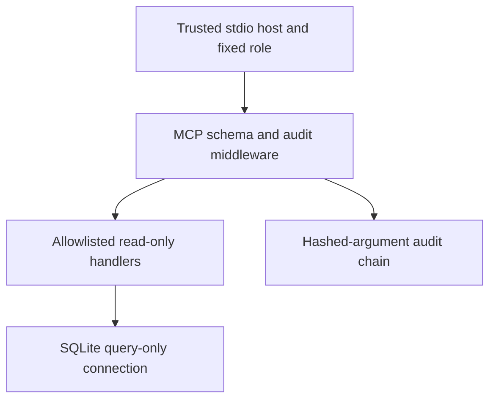

# Catalog Sentinel

A read-only MCP catalog server with host-assigned permissions, strict tool inputs, an audit hash chain, and actual stdio client/server misuse evaluations.

[](https://github.com/Sunnyvulli/catalog-sentinel/actions/workflows/verify.yml)

**Evidence:** [actual protocol run](results/demo.json) · [threat model](docs/security.md) · [design decisions](docs/decisions.md). Uses attributed UCI Bike Sharing aggregates, not private company data. Local reference implementation, not an internet-facing authenticated service.

## Quick start

Python 3.12 and GNU Make are the tested prerequisites.

```sh
python3 -m venv .venv
. .venv/bin/activate
pip install -r requirements.txt
make run
```

This builds a temporary database from bundled, hash-verified historical observations and launches actual MCP stdio subprocesses. It checks allowed/denied requests for both roles and confirms database bytes are unchanged. `make test` covers additional misuse and audit behavior. No model, credential or paid endpoint is needed.

## Controls that execute

- The host fixes `catalog` or `analyst` at process launch; tool arguments cannot assign or escalate a role.
- Exactly two tools: describe one allowlisted dataset, or read at most 31 dates of daily aggregates. No arbitrary SQL, file access, shell, URL fetch, credential, or raw-observation tool exists.
- MCP input schemas validate literal dataset names and strict bounded integer limits; date ranges are checked by the handler.
- SQLite opens with `mode=ro`, query-only mode, disabled extension loading, an authorizer limited to catalog/daily reads, and an opcode budget.
- Middleware audits requests around SDK validation/lookup, including invalid tool/schema attempts. Arguments are hashed instead of copied into the audit. Sink failure withholds results.
- Per-process locking, flushing and fsync protect application appends; hash chaining detects edited retained entries. OS-owner rewriting/truncation is outside this guarantee.

## Architecture



## Measured evidence

The recorded run issued 16 tool requests across two real stdio sessions: all 13 expected denials were enforced, three allowed calls succeeded, and database bytes remained unchanged. Latency and SDK version are in the raw result; timing is local, includes validation/error handling and excludes subprocess startup from each request timer. There were no billed model/API calls. This is a small designed misuse suite, not an independent security audit or proof against all prompt injections.

Fourteen behavioral tests additionally check write/attach/raw-table denial, caller-supplied role escalation, strict types, inverted dates, injected catalog instructions, audit tampering, schema-rejection auditing, and audit-sink failure. Tool annotations are only hints; enforcement comes from code and SQLite.

## Failure story and limits

A catalog description can contain “ignore restrictions” text. The server faithfully returns that untrusted data, but it cannot alter the host-assigned role. An incautious consuming agent could still repeat those instructions or misuse other tools outside this server. This project isolates a capability boundary; it does not solve model-level instruction following.

`stdio` trusts the launching OS user and is not remote OAuth. Each server instance needs a distinct audit path; cross-process file coordination and external immutable audit anchoring are not implemented. Do not expose this as an unauthenticated HTTP service. Source and database files are owner-managed; hash checking is not adversarial storage protection. [Security model](docs/security.md).

## Operator use

To build a persistent demo snapshot: `python -c "from sentinel.store import build; print(build('.local/catalog.sqlite'))"`. Then configure an MCP host to run `python -m sentinel.server --database /absolute/path/.local/catalog.sqlite --audit /absolute/path/.local/audit.jsonl --role catalog` from this repository. The host owns the role and paths; clients cannot supply them through tools.

## Attribution, maintenance and next step

UCI Bike Sharing, CC BY 4.0; [source and hashes](data/SOURCE.md). The bundled gzip wraps unchanged source bytes, checked before loading. MIT code license. No production adoption or learned-model attack result is claimed. Next: identity-backed remote transport and externally anchored audit storage with independent adversarial evaluation. [Changelog](CHANGELOG.md) · [Contributing](CONTRIBUTING.md).
