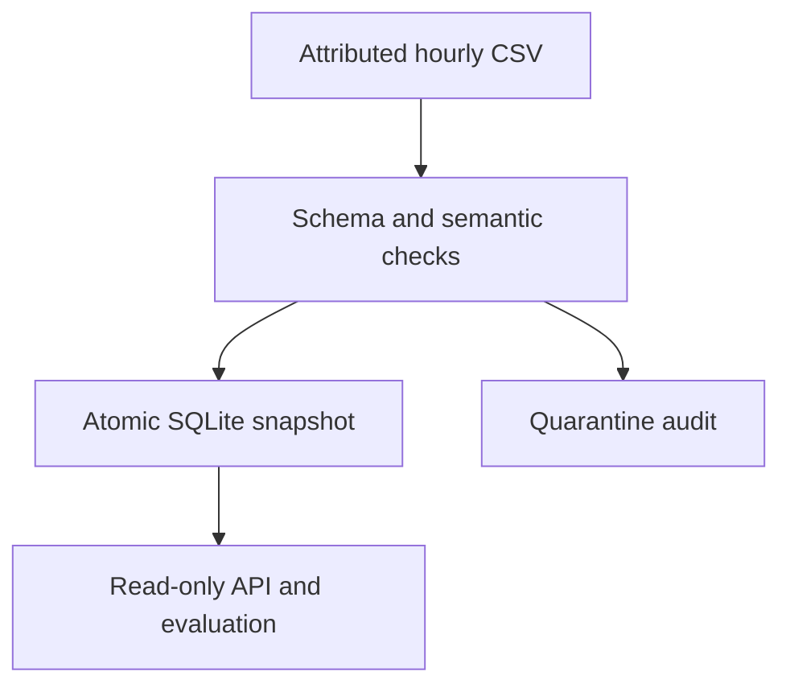

# Mobility Quality Lab

An auditable data pipeline, local analytics API, and evaluation study using real historical bike-rental observations. Source code in this project was implemented for this portfolio; the dataset and established algorithms are attributed, and no claim of worldwide novelty is made.

## Problem and scope

For measured local replay and failure recovery, run `python workload.py` from this directory. See [recorded workload results](results/workload.json) and the [evidence and ownership completion guide](../../docs/profile-evidence-next-steps.md). These measurements do not establish cloud deployment or production workload experience.
Reporting and prediction systems can produce plausible numbers even when inputs contain duplicates, inconsistent totals, or leakage. This project makes data contracts, rejected records, missing hours, and evaluation choices inspectable. It uses the complete downloaded UCI hourly dataset, not a toy sample. It is a local reference implementation, not a production service or station-level rebalancing system.

## One-command verification

From the repository root, run `make run` (Python 3.11+ and GNU Make required). This exercises real ingestion, repeat handling, and thirteen tests (ten system and three temporal-protocol tests) without installing dependencies. Research evaluation remains a separate command below.

## Quick start
Python 3.11+ recommended. Pipeline and API use only the standard library. Evaluation dependencies are pinned in requirements.txt.

```sh
cd projects/mobility-quality
python pipeline.py
python -m unittest -v
python -m pip install -r requirements.txt
python evaluate.py
python api.py
```

Open http://127.0.0.1:8080/health or http://127.0.0.1:8080/daily?start=2012-01-01&end=2012-01-07 . The API runs locally; GitHub Pages hosts the static portfolio and result files, not a Python server. Local API defaults to loopback; the container explicitly binds within its isolated network and publishes only to host loopback.

## Architecture
Immutable attributed CSV → parse and domain validation → calendar/count/key reconciliation → atomic SQLite snapshot + batch audit → parameterized read-only API and static report. SHA-256 identifies each input. Repeating the active batch returns its cached audit only after every stored observation matches the validated source; drift triggers transactional replacement. Hashing and parsing use the same captured input bytes. A historical batch can be reactivated explicitly by passing its file.

## Data contract
- Required schema must match the published hourly file.
- Numeric category and normalized-weather ranges are checked; non-finite weather values fail range checks.
- cnt must equal casual + registered; calendar fields must match dteday.
- IDs and date-hour keys must be unique; first valid occurrence wins.
- Missing hourly observations are reported as missing, never filled with zero.

## Executed results
17,379 accepted observations, 731 observed days, 3,292,679 rentals, and 165 missing date-hour slots within those days. No original row violated the implemented contract. This does not establish that the underlying data are error-free. See results/pipeline.json for the complete audit.

Ten system tests cover real-data reconciliation, idempotency, fault types, invalid schema, empty input, actual HTTP responses, observation-drift repair, exact input-byte provenance, and rollback after an injected SQLite write failure. Prediction and fault-injection measurements are in results/evaluation.json; see the research note for interpretation.

## Operational choices and limitations
Snapshot replacement, observations, and audit metadata commit in one SQLite transaction. Empty/invalid-schema batches preserve the prior snapshot. The exported JSON is downstream of that transaction; file-write failure does not roll back SQLite. Whole-file reads use memory and are unsuitable for unbounded streams. Replay compares all observation fields under an immediate writer transaction and repairs modified, deleted, or added observations. This adds a complete snapshot read and a source-row sort on replay. The source file and database schema/audit metadata remain trusted inputs; this is consistency verification, not tamper-proof storage. No authentication or TLS is implemented, so the API binds only to localhost. SQLite serves one local process; distributed operations and cloud scaling are not claimed. HTTP HEAD is not implemented. Input identifiers are dataset record IDs, not personally identifying customer records.

## Role relevance
- Data engineering: contracts, data lineage, deterministic loads, SQL aggregation, audit output, and CI.
- Backend engineering: parameterized database access, HTTP status handling, integration tests, and API documentation.
- Research assistantships: temporal evaluation, baseline comparisons, fault injection, reproducible measurements, and explicit threats to validity.
- Teaching assistantships: accompanying lesson, exercises, answer key, and scoring rubric.

## Provenance and attribution
See data/SOURCE.md. Dataset is CC BY 4.0. Standard Python libraries and scikit-learn implementations are used; their algorithms are not claimed as original contributions. Research context: Breck et al. (2019), Data Validation for Machine Learning, https://mlsys.org/Conferences/2019/doc/2019/167.pdf . Career requirements cross-check: https://www.amazon.jobs/en/jobs/10524253/data-engineer-ww-ops-finance-s-a (accessed 2026-10-18), used only to ground Python/SQL/ETL/data-quality relevance, not as an eligibility claim.

## Containerized API

From the repository root:

```sh
docker compose up --build --wait
```

Then open http://127.0.0.1:8080/health or http://127.0.0.1:8080/daily?start=2012-01-01&end=2012-01-07 . Stop with `docker compose down`. No account or API key is required; first use downloads the official Python base image.

The image builds the real-data snapshot and runs system tests. Its API runs as UID 10001; Compose publishes only to host loopback, makes the filesystem read-only, drops capabilities, and supplies temporary scratch space. A pinned-version Gitleaks history scan and container build/HTTP checks run in CI. Inspect the workflow before treating container verification as complete.



## Highlights
- 17,379 real historical observations covering 731 dates.
- Thirteen tests (ten system and three temporal-protocol tests), including actual HTTP responses and snapshot preservation.
- Three-seed assessment: forest MAE 45.687 rentals/hour on a chronological holdout; lower shuffled error is reported separately.
- 54 controlled fault-policy evaluations; raw results and limitations included.

[](https://github.com/Sunnyvulli/Sunnyvulli.github.io/actions/workflows/career.yml)

Decision log: [../../docs/decisions.md](../../docs/decisions.md).

## Whole-day temporal backtest

Run `make backtest` from the repository root after installing requirements.txt. Three expanding-history, whole-day windows cover 84 days. Calendar-only forest weighted MAE: 49.766 rentals/hour; online weekly-lag baseline: 64.031. The baseline assumes seven-day-old observed counts are available as each test hour arrives; this is not a fixed 28-day-ahead forecast. See [protocol](../../research/temporal-followup.md), [build note](../../docs/build-notes-temporal.md), and results/temporal-evaluation.json for limits, versions, boundaries, and exploratory uncertainty.
